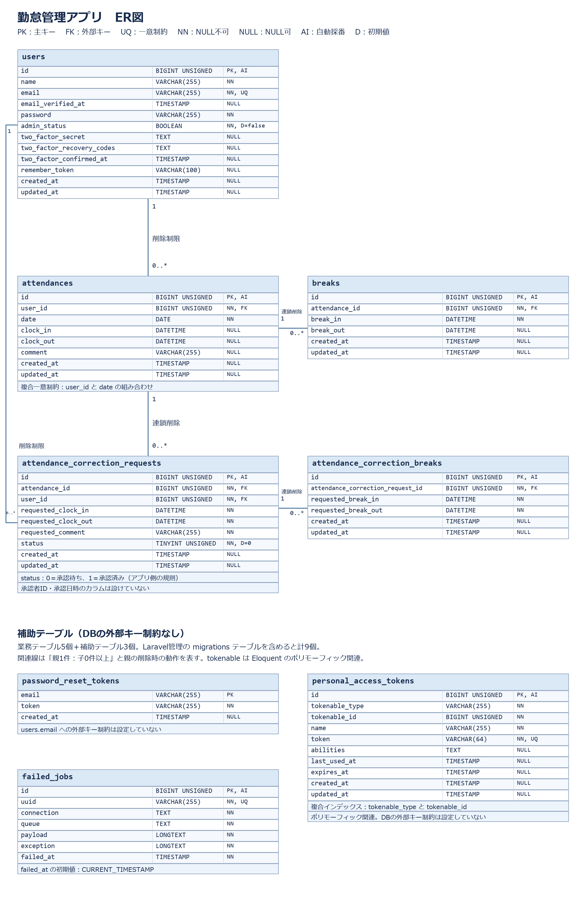

# COACHTECH 勤怠管理アプリ

一般ユーザーの出退勤・休憩と、管理者による勤怠確認・修正申請の承認を管理するWebアプリケーションです。

## 主な機能

### 一般ユーザー

- 会員登録・ログイン・ログアウト
- メール認証・認証メールの再送
- 出勤・退勤・休憩開始・休憩終了の打刻
- 自分の月次勤怠一覧・勤怠詳細の確認
- 勤怠修正申請・承認待ち／承認済み申請の確認
- マイ勤怠レポートによる勤務統計・月別推移・異常値の確認

### 管理者

- 管理者ログイン・ログアウト
- 日次勤怠一覧・勤怠詳細の確認と修正
- スタッフ一覧・スタッフ別月次勤怠の確認
- スタッフ別月次勤怠のCSV出力
- 勤怠修正申請の確認・承認

### 公開API

- 認証不要の勤怠一覧・詳細取得
- Laravel Sanctum認証による勤怠登録・更新・削除
- 更新・削除は本人または管理者に限定
- 検索・ページネーション・PUT／PATCHによる部分更新

## 使用技術

| 技術 | 確認済みバージョン・用途 |
| --- | --- |
| PHP | 8.5.11 |
| Laravel | 10.50.3 |
| MySQL | 8.4.11 |
| Node.js | 24.21.0 |
| npm | 12.2.0 |
| Laravel Sail | 1.67.0／Docker開発環境 |
| Laravel Fortify | 1.36.2／Web認証・メール認証 |
| Laravel Sanctum | 3.3.3／API認証 |
| PHPUnit | 10.5.64／自動テスト |
| Laravel Pint | 1.30.4／コードスタイル確認 |
| Vite | 5系／フロントエンドビルド |

上記は開発環境で確認したバージョンです。PHPの起動環境は`compose.yaml`のSail 8.5、MySQLは`mysql:8.4`を使用します。依存パッケージは各ロックファイルに従ってインストールします。

## 環境構築

WindowsではWSL2上のLinux環境を使用し、Docker DesktopのWSL連携を有効にしてください。以降のコマンドはLinux側のターミナルで実行します。GitとDocker Composeを使用します。

### 1. リポジトリを取得

```bash
git clone https://github.com/715OXY/attendance-app.git
cd attendance-app
```

非公開リポジトリの場合は、アクセス権限のあるGitHubアカウントで取得してください。

### 2. Composer依存パッケージをインストール

課題指定のComposer用コンテナで依存パッケージを取得します。このコンテナは初回インストール用で、アプリケーションの起動用PHPとは別です。

```bash
docker run --rm \
  -u "$(id -u):$(id -g)" \
  -v "$(pwd):/var/www/html" \
  -w /var/www/html \
  -e COMPOSER_CACHE_DIR=/tmp/composer_cache \
  laravelsail/php82-composer:latest \
  composer install
```

### 3. 環境変数を設定

```bash
cp .env.example .env
```

`.env`の該当項目を次のローカル開発用設定に変更してください。

```dotenv
APP_ENV=local
APP_DEBUG=true
APP_URL=http://localhost

DB_CONNECTION=mysql
DB_HOST=mysql
DB_PORT=3306
DB_DATABASE=laravel
DB_USERNAME=sail
DB_PASSWORD=password

MAIL_MAILER=smtp
MAIL_HOST=mailpit
MAIL_PORT=1025
MAIL_USERNAME=null
MAIL_PASSWORD=null
MAIL_ENCRYPTION=null
MAIL_FROM_ADDRESS="hello@example.com"
MAIL_FROM_NAME="${APP_NAME}"
```

記載しているDB接続情報はローカル開発用の例です。実運用の認証情報、APIトークン、生成したAPP_KEY、`.env`はGitへ登録しません。

### 4. 提供画像を手動配置

提供リポジトリの`public/images/`から、次の画像を本アプリの`public/images/`へ手動でコピーしてください。

- `logo.svg`
- `arrow.png`
- `calender.png`（提供ファイルの綴りのまま使用）

取得元：[提供Bladeテンプレートリポジトリ](https://github.com/coachtech-prepared-file/Preparedblade-mockcase-Attendance)

本アプリは応用機能用の`advanced`ブランチの提供リソースを使用します。提供リポジトリは本アプリとは別のフォルダへ取得してください。

```bash
git clone -b advanced https://github.com/coachtech-prepared-file/Preparedblade-mockcase-Attendance.git ../Preparedblade-mockcase-Attendance
mkdir -p public/images
```

エクスプローラー等で画像をコピーします。`public/images/`はGit管理対象外です。提供済みのBladeは変更せず、クローン済みアプリの`resources/`を再度上書きする作業は不要です。

### 5. Sailを起動

```bash
./vendor/bin/sail up -d
```

以降は、次のエイリアスを設定して`sail`を使用します。新しいターミナルでも利用する場合は、シェルの設定ファイルへ登録してください。

```bash
alias sail='[ -f sail ] && bash sail || bash vendor/bin/sail'
```

初回起動ではコンテナの構築とMySQLの初期化に時間がかかります。

### 6. アプリケーションキーとDBを初期化

```bash
sail artisan key:generate
sail artisan migrate --seed
```

MySQLの起動直後に接続エラーとなる場合は、初期化完了後に`migrate --seed`を実行してください。

### 7. フロントエンドを起動

```bash
sail npm ci
sail npm run dev
```

Viteの開発サーバーを動かしたまま、ブラウザーでアプリへアクセスします。停止は`Ctrl+C`です。

## アクセス先・動作確認用アカウント

| 用途 | URL |
| --- | --- |
| 一般ユーザーログイン | http://localhost/login |
| 一般ユーザー会員登録 | http://localhost/register |
| 管理者ログイン | http://localhost/admin/login |
| phpMyAdmin | http://localhost:8080/ |
| Mailpit | http://localhost:8025/ |

上記URLは既定のポート設定の場合です。

| 種別 | 氏名 | メールアドレス | パスワード |
| --- | --- | --- | --- |
| 一般 | 一般ユーザー1 | user1@example.com | password |
| 一般 | 一般ユーザー2 | user2@example.com | password |
| 管理者 | 管理者ユーザー | user3@example.com | password |

いずれもSeederが作成するローカル動作確認専用アカウントで、メール認証済みです。会員登録時の認証メールはMailpitで確認できます。

Seederは一般ユーザー1に過去6か月分（前月まで）のレポート確認用データを、一般ユーザー2と管理者に前月の勤怠データを作成します。月次一覧でデータを確認する際は前月を選択してください。

## 日常の起動・停止

起動時はリポジトリ直下で次を実行します。

```bash
sail up -d
sail npm run dev
```

停止時はViteを`Ctrl+C`で終了してから、コンテナを停止します。

```bash
sail down
```

ビルド済みアセットを使用する場合は、Viteの開発サーバーを停止してから次を実行します。

```bash
sail npm run build
```

開発サーバー停止後に`public/hot`が残っている場合は、この生成ファイルを削除してからビルド済みアセットの表示を確認します。

## DBの再初期化

次のコマンドは、接続先DBの全テーブルと保存データを削除して再作成します。ローカルの動作確認データを初期状態へ戻す場合だけ実行してください。

```bash
sail artisan migrate:fresh --seed
```

Seederの再実行だけでは既存アカウントと重複するため、初期状態に戻す用途では上記コマンドを使用します。

## テスト・コードスタイル確認

`phpunit.xml`は、アプリ用DBと別の`testing`データベースを指定しています。テスト実行前にMySQLとアプリのコンテナを起動してください。

```bash
sail artisan config:clear
sail artisan test
sail bin pint --test
```

特定のテストだけを実行する例：

```bash
sail artisan test --filter=D21NPlusOneTest
```

確認済みの結果：全159件成功・707 assertions、Pintは154ファイル成功。

MySQLボリュームの初回作成時には、Sailの初期化スクリプトが`testing`データベースを作成します。既存ボリュームに`testing`がない場合は、次のコマンドでMySQLへ接続し、ローカル開発用のrootパスワードを入力してください。

```bash
sail exec mysql mysql -u root -p
```

MySQL内で次を実行します。

```sql
CREATE DATABASE IF NOT EXISTS testing;
GRANT ALL PRIVILEGES ON testing.* TO 'sail'@'%';
exit;
```

テストはテスト用DB内のデータを作成・削除します。アプリ用DBをテスト用DBとして指定しないでください。

## 公開API

| メソッド | URI | 認証・認可 |
| --- | --- | --- |
| GET | `/api/v1/attendance-records` | 認証不要 |
| GET | `/api/v1/attendance-records/{attendanceRecord}` | 認証不要 |
| POST | `/api/v1/attendance-records` | Sanctum認証 |
| PUT / PATCH | `/api/v1/attendance-records/{attendanceRecord}` | Sanctum認証、本人または管理者 |
| DELETE | `/api/v1/attendance-records/{attendanceRecord}` | Sanctum認証、本人または管理者 |

一覧は`user_id`、`date`（YYYY-MM-DD）、`month`（YYYY-MM）、`page`、`per_page`で指定できます。`per_page`の既定値は20、最大値は100です。

Bearerトークンを使用する場合は`Authorization: Bearer <token>`を付けます。JSONリクエストには`Content-Type: application/json`と`Accept: application/json`を指定します。トークン値はREADMEへ記載しません。

PUT・PATCHともに未送信項目を保持します。`date`と`clock_in`は送信時に必須（NULL不可）、`clock_out`と`comment`はNULLへ更新できます。

## 設計資料・ER図

- [要件シート・基本設計書・テーブル仕様書](docs/requirements.xlsx)
- [ER図の画像](docs/er-diagram.png)
- [公開APIの実装補足](docs/api-implementation.md)



業務テーブル5個と補助テーブル3個を掲載しています。Laravel管理の`migrations`テーブルを含めると計9個です。

## 提供リソースの取り扱い

Bladeテンプレート・CSS・JavaScriptは課題で提供されたリソースを使用します。提供Bladeは変更しません。

画面が要求するルート名・URL・データ形式との整合性は、バックエンドで対応しています。翻訳メッセージは`lang/`へ配置し、外部翻訳パッケージは使用していません。
